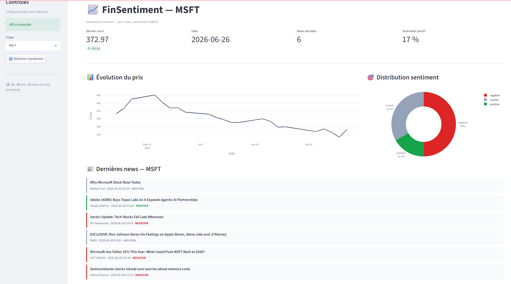
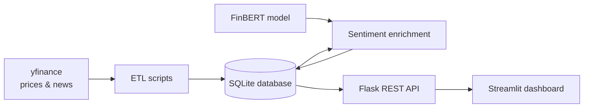
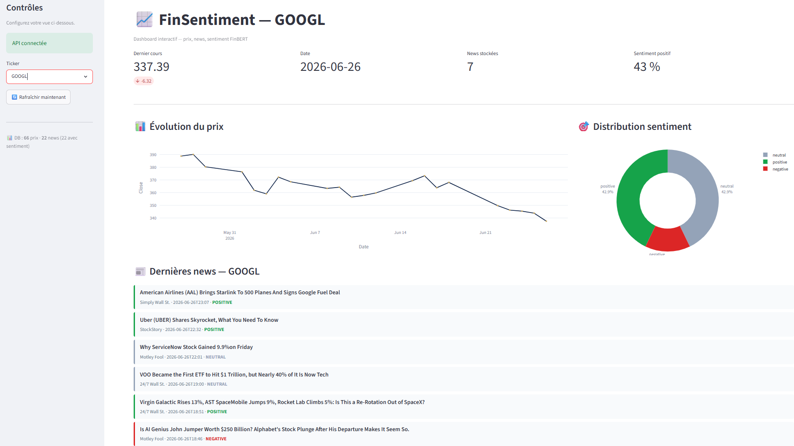
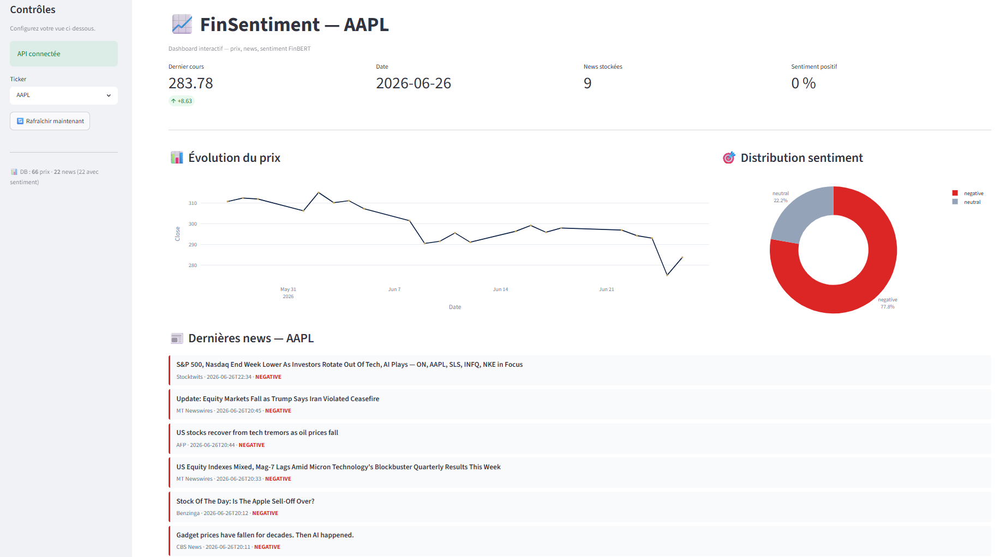

# 📈 FinSentiment

[](https://github.com/SamarProjects/finapi-finsentiment-SamarKhelifi/actions/workflows/ci.yml)

[](https://huggingface.co/spaces/SamarProjects/finsentiment)

**FinSentiment** is a financial news sentiment analysis application. It collects stock prices and financial news, classifies each headline as positive, neutral or negative with **FinBERT**, a language model specialized in financial text, and presents the results in an interactive dashboard.

🔗 **Live demo:** [huggingface.co/spaces/SamarProjects/finsentiment](https://huggingface.co/spaces/SamarProjects/finsentiment)



---

## Problem

Investors are exposed to a constant flow of financial news, and reading every article to judge the market mood around a stock is not realistic. General-purpose sentiment tools also tend to misread financial language. For example, *"costs decreased"* is good news, even though "decreased" sounds negative.

## Objectives

- Automatically collect recent prices and news for a list of stock tickers
- Score each news headline with a sentiment model trained on financial text
- Store everything in a database and expose it through a REST API
- Provide a simple dashboard that shows prices and news sentiment side by side
- Keep the code reliable with automated tests, linting and continuous integration

## Main features

- **Data pipeline (ETL):** downloads one month of daily prices and the latest news for each ticker with `yfinance`, removes duplicate articles and stores them in SQLite
- **Sentiment analysis:** classifies headlines with [ProsusAI/finbert](https://huggingface.co/ProsusAI/finbert), with batch processing and tokenizer-based truncation to FinBERT's 512-token limit
- **REST API (Flask):** endpoints for live prices, price history, stored data and on-demand sentiment analysis
- **Interactive dashboard (Streamlit + Plotly):** ticker selector, key metrics, price chart, sentiment distribution chart and a color-coded news feed
- **Quality:** 14 automated tests, Ruff linting and a GitHub Actions pipeline that runs on every push

## Architecture



```
finapi-finsentiment-SamarKhelifi/
├── finapi/                  # Backend
│   ├── app.py               # Flask REST API
│   ├── db.py, models.py     # SQLAlchemy database and models
│   ├── prices.py            # Market data access (yfinance)
│   ├── sentiment.py         # FinBERT sentiment service
│   └── etl/                 # Price and news ingestion
├── dashboard/               # Frontend
│   ├── app.py               # Streamlit dashboard
│   ├── api_client.py        # HTTP client for the API
│   └── charts.py            # Plotly charts
├── scripts/                 # run_etl.py, enrich_sentiment.py
├── tests/                   # pytest test suite
├── docs/screenshots/        # Dashboard screenshots
└── .github/workflows/ci.yml # GitHub Actions pipeline
```

### API endpoints

| Method | Endpoint | Description |
|---|---|---|
| GET | `/health` | API health check |
| GET | `/price/<ticker>` | Latest market price |
| GET | `/history/<ticker>` | Price history |
| GET | `/db/prices/<ticker>` | Stored prices |
| GET | `/db/news/<ticker>` | Stored news with sentiment |
| GET | `/db/stats` | Database statistics |
| GET | `/db/sentiment-summary/<ticker>` | Sentiment distribution for a ticker |
| POST | `/sentiment` | Analyze one text: `{"text": "..."}` |
| POST | `/sentiment/batch` | Analyze several texts in one call |

## Technologies

| Area | Tools |
|---|---|
| Language | Python |
| API | Flask |
| Database | SQLite, SQLAlchemy |
| Market data | yfinance |
| NLP / AI | Hugging Face Transformers, FinBERT, PyTorch |
| Dashboard | Streamlit, Plotly |
| Testing & quality | pytest, pytest-cov, Ruff |
| CI / Deployment | GitHub Actions, Hugging Face Spaces |

## Installation

Requires **Python 3.11+**.

```bash
git clone https://github.com/SamarProjects/finapi-finsentiment-SamarKhelifi.git
cd finapi-finsentiment-SamarKhelifi
python -m venv .venv
```

Activate the virtual environment:

```bash
# Windows (PowerShell)
.venv\Scripts\Activate.ps1

# macOS / Linux
source .venv/bin/activate
```

Install the dependencies:

```bash
pip install -r requirements.txt
```

## Usage

**1. Collect prices and news**

```bash
python scripts/run_etl.py AAPL MSFT GOOGL TSLA
```

**2. Compute the sentiment of the news** (FinBERT is downloaded on first use)

```bash
python scripts/enrich_sentiment.py
```

**3. Start the API** (terminal 1)

```bash
python -m finapi.app
```

**4. Start the dashboard** (terminal 2)

```bash
streamlit run dashboard/app.py
```

Then open http://localhost:8501.

### Configuration

The API address is not hard-coded. It is read from environment variables, so the dashboard and the API can run on different machines. The default values are listed in [`.env.example`](.env.example).

| Variable | Default | Used by |
|---|---|---|
| `FINAPI_URL` | `http://localhost:5000` | Dashboard: address of the API |
| `FINAPI_HOST` | `127.0.0.1` | API: host to listen on |
| `FINAPI_PORT` | `5000` | API: port to listen on |
| `FINAPI_DEBUG` | `false` | API: Flask debug mode |

Example (PowerShell):

```powershell
$env:FINAPI_URL = "http://my-server:5000"
streamlit run dashboard/app.py
```

## Testing & continuous integration

The project includes **14 automated tests** with `pytest`:

- **API tests:** check the Flask routes and their responses using Flask's test client
- **Health tests:** check that the application starts and responds
- **Sentiment tests:** check FinBERT results and input validation. FinBERT is mocked, so these tests run fast, and one test checks that long texts are truncated by tokens, not by characters

Run the tests and the linter locally:

```bash
python -m pytest --cov=finapi --cov-report=term-missing
ruff check .
```

On every push and pull request to `main`, **GitHub Actions** installs the project, runs Ruff and runs the full test suite with coverage. The badge at the top of this page shows the current status.

## Screenshots

**Microsoft (MSFT)**: overview with sidebar controls


**Alphabet (GOOGL)**: mixed sentiment



**Apple (AAPL)**: mostly negative news



## Deployment

A live version runs on **Hugging Face Spaces**: [SamarProjects/finsentiment](https://huggingface.co/spaces/SamarProjects/finsentiment).

Hugging Face Spaces runs a single application, so the deployed version starts the dashboard on a preloaded database and reads the data directly from SQLite instead of calling the Flask API. The full API + dashboard architecture described above is the one in this repository.

## Context & my contribution

FinSentiment started as an **academic project** in a *Python for Finance* course (2026). The core application (data pipeline, Flask API, FinBERT integration and Streamlit dashboard) was built step by step through four guided labs.

On top of the course work, **I personally implemented or improved:**

- **Automated testing:** wrote the pytest test suite (14 tests), including FinBERT mocking so the tests run without downloading the model
- **Code quality & CI:** set up Ruff linting, `pyproject.toml` configuration and the GitHub Actions pipeline that runs linting and tests on every push
- **Deployment:** deployed the application to Hugging Face Spaces, with a preloaded database and an entry point adapted to the platform
- **Configurable API:** replaced the hard-coded `localhost` address and port with environment variables, and turned Flask debug mode off by default
- **FinBERT truncation fix:** the original code cut texts at 512 *characters*, while FinBERT's limit is 512 *tokens*. Truncation is now done by the tokenizer, and a test covers it
- **Dashboard fixes:** made news headlines readable and stopped the sentiment chart labels from being cut off
- **Portfolio cleanup:** removed course-specific references, wrote this documentation and added screenshots

## Possible improvements

- Schedule the ETL to refresh data automatically every day
- Deploy the API and the dashboard as separate services
- Compare daily sentiment with next-day price changes
- Add more tickers and news sources